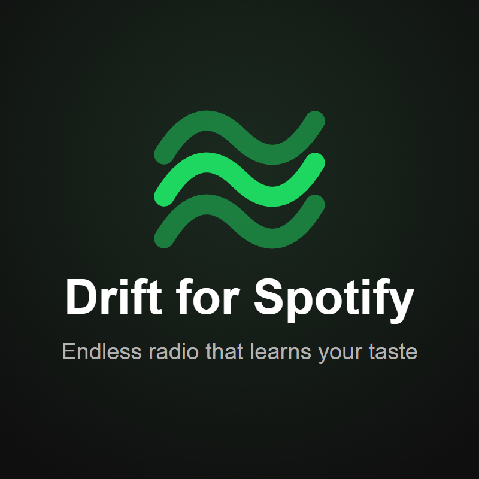

# Drift for Spotify

**An endless personal wave that learns from you and almost never repeats a song.**
A [Spicetify](https://spicetify.app) extension. Press one button — Drift keeps playing music you like and music you'll like, forever.



[English](#english) · [Русский](#русский)

---

## English

### What it does
- **One button, endless music.** A wave icon appears next to Shuffle. Click it — the queue never runs out.
- **Learns as you listen.** Likes pull the wave toward a sound; skips push it away. Fresh likes count more than old ones.
- **Almost no repeats.** The same song won't come back for a long time, and the same artist doesn't show up every few tracks.
- **Three characters:** *Favorites* (what you already love), *Discover* (new artists close to your taste), *Popular*.
- **Doesn't fight Spotify.** Drift adds one track at a time to the regular queue — Back, Like and your own "Add to queue" all work as usual.

**Try Pro free for 7 days:** [@Spotify_drift_bot](https://t.me/Spotify_drift_bot?start=trial) · Subscription: [Boosty](https://boosty.to/meenbeens)

### Install
**Spicetify Marketplace** (easiest): open Marketplace in Spotify → search **Drift for Spotify** → Install.

**Manually:**
1. Install [Spicetify](https://spicetify.app/docs/advanced-usage/installation) (Spotify from spotify.com, not the Microsoft Store).
2. Download [`drift.js`](drift.js) and put it into the Extensions folder:
   Windows — `%appdata%\spicetify\Extensions`, macOS / Linux — `~/.config/spicetify/Extensions`.
3. Run:
   ```
   spicetify config extensions drift.js
   spicetify apply
   ```
4. A wave icon appears next to the Shuffle button — click it.

Spotify updated and Drift disappeared? Run `spicetify backup apply`.

### Privacy
Free Drift has no server and no account. Besides Spotify itself it only downloads two public files from GitHub: a list of AI-generated artists to skip ([soul-over-ai](https://github.com/xoundbyte/soul-over-ai)) and, once a day, this repository's `manifest.json` to see if there's a new version. Nothing about you is sent.
Everything it learns (likes, skips, history) stays in your Spotify on your computer.

### Help
Something wrong or have an idea — write to [@Spotify_drift_bot](https://t.me/Spotify_drift_bot) or open an issue.
Step-by-step guide with screenshots: [Telegraph](https://telegra.ph/How-to-install-Drift-for-Spotify-11-02) · [Terms and Privacy](https://telegra.ph/Drift-for-Spotify--Terms-and-Privacy-11-02)

---

## Русский

### Что это
- **Одна кнопка — бесконечная музыка.** Рядом с «Перемешать» появляется значок волны. Нажми — и очередь не кончается.
- **Учится, пока слушаешь.** Лайк тянет волну к такому звучанию, скип — уводит. Свежие лайки весят больше старых.
- **Почти без повторов.** Песня долго не вернётся, а один артист не мелькает каждые несколько треков.
- **Три характера:** *Любимое* (то, что ты уже любишь), *Незнакомое* (новые артисты рядом с твоим вкусом), *Популярное*.
- **Не ломает Spotify.** Drift ставит в обычную очередь по одному треку — «Назад», лайки и твоё «Добавить в очередь» работают как обычно.

### Free и Pro

| | Free | Pro |
|---|:---:|:---:|
| Бесконечная волна, три характера | ✅ | ✅ |
| Учится на лайках и скипах | ✅ | ✅ |
| Помнит сыгранное | ~200 песен | ~2000 песен |
| Настроение, язык, занятие, жанр | — | ✅ |
| Мгновенная реакция на лайк (похожее — сразу следом) | — | ✅ |
| Помнит дизлайки и артистов, которых скипаешь | — | ✅ |
| Drift по любому артисту или плейлисту | — | ✅ |
| Сохранённые волны | — | ✅ |
| Итог месяца | — | ✅ |

**Pro бесплатно на 7 дней:** [@Spotify_drift_bot](https://t.me/Spotify_drift_bot?start=trial) · Подписка: [Boosty](https://boosty.to/meenbeens)

### Установка
**Marketplace Spicetify** (проще всего): открой Marketplace в Spotify → найди **Drift for Spotify** → Install.

**Вручную:**
1. Поставь [Spicetify](https://spicetify.app/docs/advanced-usage/installation) (Spotify — с spotify.com, не из Microsoft Store).
2. Скачай [`drift.js`](drift.js) и положи в папку расширений:
   Windows — `%appdata%\spicetify\Extensions`, macOS / Linux — `~/.config/spicetify/Extensions`.
3. Выполни:
   ```
   spicetify config extensions drift.js
   spicetify apply
   ```
4. Рядом с кнопкой «Перемешать» появится значок волны — нажми его.

Spotify обновился и Drift пропал — выполни `spicetify backup apply`.

### Приватность
У бесплатного Drift нет сервера и аккаунта. Кроме самого Spotify он скачивает только два открытых файла с GitHub: список ИИ-артистов, которых волна пропускает ([soul-over-ai](https://github.com/xoundbyte/soul-over-ai)), и раз в сутки `manifest.json` этого репозитория — проверить новую версию. О тебе ничего не отправляется.
Всё, что он узнаёт (лайки, скипы, история), остаётся в твоём Spotify на твоём компьютере.

### Помощь
Что-то не так или есть идея — пиши в [@Spotify_drift_bot](https://t.me/Spotify_drift_bot) или открой issue.
Инструкция со скриншотами: [Telegraph](https://telegra.ph/Kak-ustanovit-Drift-for-Spotify-11-02) · [Условия и конфиденциальность](https://telegra.ph/Drift-for-Spotify--usloviya-i-konfidencialnost-11-02)

---
Spotify is a trademark of Spotify AB. Drift is not affiliated with Spotify. © 2026 bayok — see [LICENSE](LICENSE).
